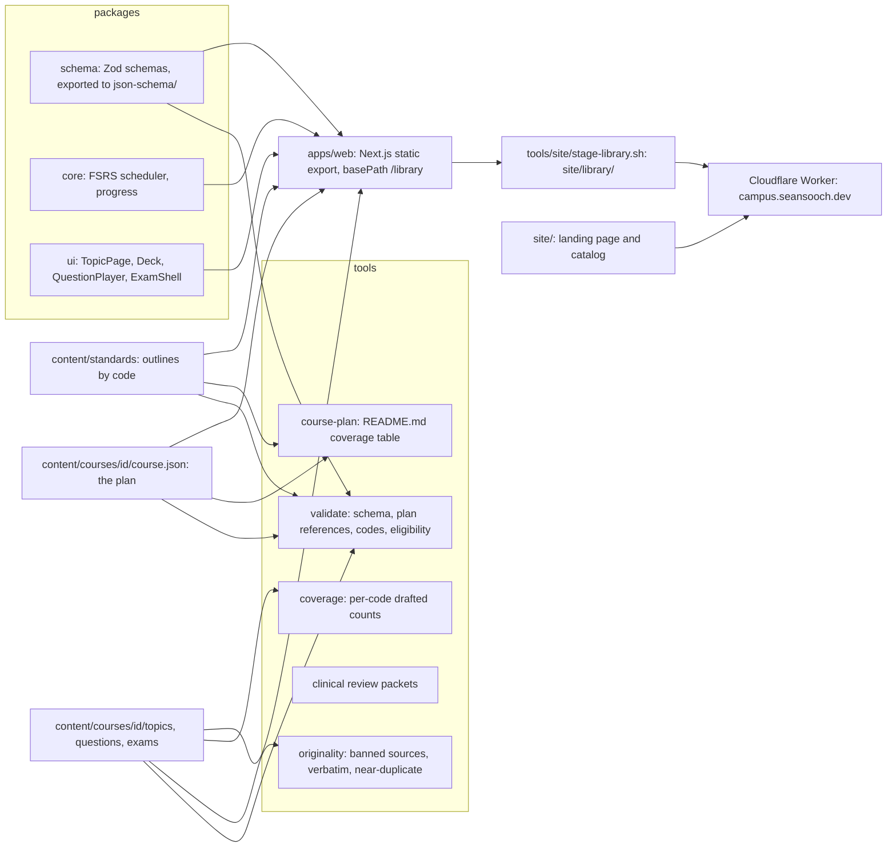
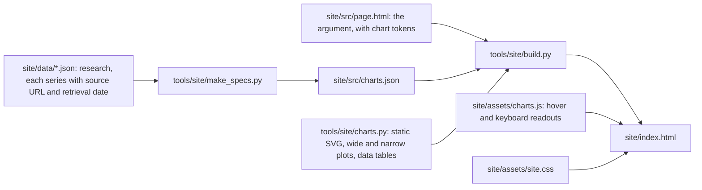

# Architecture

The design and its reasons are in [SPEC.md](SPEC.md) (sections 4, 6 and 7). This file says what exists in the repository today.

## State on 2026-11-17

Stage 0, Track A, step 1 is done: the repository exists, with its licenses and the code imported from a private pre-med library (decision 9).

Track A step 2 is done for courses: standards, courses, topics, cards, question sets and exams are all keyed by outline code, and the imported MCAT model (its enums, taxonomy, guides, school profiles and paths) is gone. `ProgramSchema`, the append-only verification list and `standards/cip-2020.json` are not built yet.

GE-111 College Algebra is at T1 Outlined with its first topic drafted and checked by a second lane: `real-numbers` (lesson, 16 cards, 12 practice questions), verified by Codex `gpt-5.6-sol`. The library app is live at https://campus.seansooch.dev/library/.



| Path | What it is |
|---|---|
| `packages/schema` | Zod schemas: standards (`standard.ts`: outlines by code with levels, parents, weights and dimensions), courses (`course.ts`: anchors, the topic plan in teaching order with codes, unit types and objectives, tier, and `courseCoverage`), topics (`topic.ts`: only what is drafted; title, codes and objectives come from the plan), card decks and question sets (each item tagged by outline code), and course exams; `json-schema/` is generated by `pnpm --filter @open-campus/schema export` |
| `packages/core` | FSRS scheduler and progress store (localStorage key `open-campus-progress`) |
| `packages/ui` | React components: `TopicPage` (takes the plan entry and status), `Deck`, `QuestionPlayer` |
| `apps/web` | Next.js static export with Pagefind search, served under `/library`. Routes: `/` (courses), `/courses/<id>/` (anchors, plan with per-topic status, coverage by weighted area), `/courses/<id>/<topic>/` (lesson with KaTeX and GFM tables, cards, links to practice), `/courses/<id>/questions/<set>/` (tutor-mode player). Internal links go through `lib/paths.ts` `href()` because plain anchors do not get Next's basePath. Empty dynamic routes render a placeholder that `scripts/prune-placeholders.mjs` deletes |
| `tools/` | The gates: `validate` (standard and course ids; anchors; from T1 every leaf code covered; every drafted topic, deck, set and exam belongs to its course plan, and every card or question code belongs to its topics), `originality` (standards may name their publisher), `coverage` (per course and code: planned and drafted topics, cards, questions), `clinical:packet` and `clinical:apply` (grouped by course); `course-plan` writes each course's generated `README.md` (`--check` fails when stale) |
| `tools/test/fixtures/content` | Test fixtures only: an example outline and course `ex-100` with one drafted topic (diagrams in svg, mermaid and SMILES), a deck and a question set, all `example: true` |
| `content/standards/` | Outside outlines by code. First: CLEP College Algebra (codes CA-1 to CA-4.3 assigned by Open Campus; the publisher numbers nothing) |
| `content/courses/<id>/` | `course.json` (the plan), its generated `README.md`, `topics/<topic>/` (`topic.mdx`, `cards.json`, `diagrams/`), `questions/<set>.json` and `exams/<id>.json`. First: GE-111 |
| `site/` | The case page (`/`) and the catalog (`/catalog/`), built from `site/src` and `site/data` by `tools/site/`; `site/library/` is generated by `pnpm stage` and gitignored |

## What was removed on import

A partner site's lesson crosswalk (its lesson map, the schemas and topic fields that referenced it, its checker and tests). Also not imported: the library's content, docs, notes, README, roadmap, deploy notes and license. Removed after import (2026-11-17), when the first topic was drafted: the MCAT section, subject, concept, category and skill enums, the MCAT taxonomy and its checks, and the pre-medicine guide, school profile and path schemas (pre-medicine is AdmissionsAcademy's, SPEC 5.8).

## The site

`site/` is served at https://campus.seansooch.dev by the Cloudflare Worker in `wrangler.jsonc` (static assets only, real 404s). Deploy from the repo root with `pnpm ship`, which builds the library app, stages it at `site/library/` and runs `wrangler deploy`; a bare `npx wrangler deploy` would ship whatever `site/library/` last held.

The landing page is the case for Open Campus: a long-form argument with nine figures. It is generated, never hand-edited:



The catalog page (`/catalog/`) is built the same way: `tools/site/make_catalog.py <research JSON>` writes `site/data/catalog.json` (public fields only; pre-medicine as a partner link; no MCAT anchors), and `tools/site/build_catalog.py` writes `site/catalog/index.html`; `site/assets/catalog.js` adds search. Test with `python3 -m unittest tools/site/test_catalog.py`.

Rebuild the case page with `python3 tools/site/make_specs.py && python3 tools/site/build.py`; test with `python3 -m unittest tools/site/test_charts.py`. The build refuses unknown or unused chart ids, leftover tokens, and em or en dashes. Bump the `?v=` on `site.css` and `charts.js` in `page.html` when either changes. The library app is served at `/library/` beside it (decided 2026-11-17); the landing page stays the front door.

## Known gap

CI (`.github/workflows/ci.yml`, pull requests only) runs typecheck, tests, `validate`, `course-plan --check`, `lint:originality` and `build` against `content/`; all pass locally since the course pages landed. Topics, cards and questions still use the imported MCAT tags (see the state section).

## Running

Needs Node 20 or later and pnpm 10.

```bash
pnpm install
```

```bash
pnpm test
```

```bash
pnpm typecheck
```
