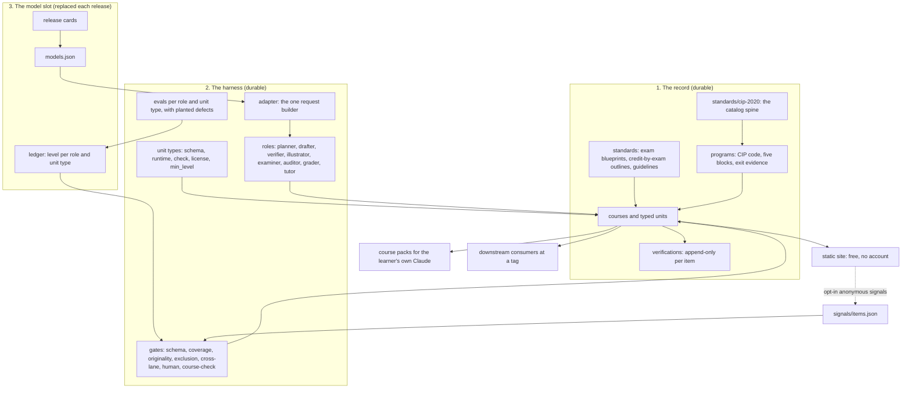

# Open Campus: a free, open source university across every major degree, re-run on every model release

Name chosen 2026-11-17 (see decision 2). Draft v0.2, 2026-11-17. Supersedes v0.1 (pre-med only).

What changed from v0.1: breadth is now a founding assumption. The catalog covers every major degree, keyed by the federal CIP taxonomy, with a shared general education core and 70 researched programs across 11 colleges (detail per program in [CATALOG.md](CATALOG.md)). Stages are replaced by catalog tiers that every course and program carries. The blockers from a 9-agent review of v0.1 are folded in. Facts not confirmed on a primary page are marked "unconfirmed". Nothing here is decided until Sean decides it; section 15 lists those decisions.

## 0. Glossary

- **Record.** Everything learners use, as plain data in the repository: standards, courses, units, programs, verification history.
- **Standard.** An outline the project does not write, referenced by code: an exam blueprint, a credit-by-exam outline, a curriculum guideline, a competency framework, or the CIP taxonomy itself.
- **Unit.** One typed piece of a course (prose, cards, mcq, lab, code, math, ledger and so on; section 6).
- **Role.** A job in the harness: planner, drafter, verifier, illustrator, examiner, auditor, grader, tutor. That list is complete.
- **Lane.** One model ID (or one named human) used in one role on one item. Two lanes are distinct when their model IDs differ. Effort, prompt, account and session do not make a new lane. **Cross-lane** means the verifier's lane differs from the drafter's. **Cross-family** means the two lanes come from different vendors.
- **Level.** How much a model may do unsupervised in a role, per unit type: L0 to L5 (section 8).
- **Tier.** How finished a course or program is: T0 Listed to T5 Proven (section 10).
- **Course pack.** The generated bundle that lets a learner's own Claude teach a course (section 11).
- **Release card.** The measured record of one model release (section 9 and the appendix).

## 1. What this is

A free, open source place to learn any major's worth of university material, where:

- the library is data in a public repository under an open license;
- every item carries an append-only record of who drafted it, who checked it, with which model, and when;
- every course maps by code to an outside standard, and every program to an outside exam or framework, so progress is measured somewhere the project does not control;
- the system that writes, checks and teaches is a harness with a replaceable model, so each Claude release improves the university by running a fixed procedure.

It is not an accredited institution and grants no degrees or credit (section 12 says exactly what may be claimed).

Compared with Khan Academy, the bet differs in four ways. **License:** Khan Academy's content is openly licensed but NonCommercial-ShareAlike; ours allows any reuse with attribution, including in paid products. **Provenance:** a public verification record per item. **Maintenance:** a scheduled re-audit of the whole library at each model release. **Tutor:** Khan Academy sells Khanmigo ($4 a month or $44 a year for learners, free for teachers, as listed on 2026-11-16); ours is a course pack loaded into the learner's own Claude, which costs the project nothing and works on Claude's free plan, within that plan's limits. The tutor is always optional: the static site alone must be enough to reach every exam. What we do not claim: Khan Academy already has per-skill mastery levels and a free MCAT collection made with the AAMC. Our breadth (every major, not K-12 plus selected college subjects) and our exportable, provenance-backed record are what must be new.

## 2. What we already have

| Asset | What it proves | Rights | Role here |
|---|---|---|---|
| The schema and tools kernel (from a private pre-med library) | Content as data with Zod schemas; tags to an outline by code; originality checks; cross-lane verification on every task PR; clinical items gated on a named reviewer; FSRS; static export with search | Code reused under Apache-2.0; the library's content stays private | The kernel of this repo, to be generalized from one exam to any standard |
| The Lab (25 mechanism lessons, `lab/FORMAT.md`, `lab-check`, art library) | An interactive lesson format and a machine gate that refuses off-format lessons | Sean's, in the seansooch.dev repo | The `lab` unit type, if the kit is opened (decision 7) |
| Qbank pipeline record | Chunked authoring, independent review, planted-defect controls, "a voice before a pen", per-flag adjudication | Questions derive from third-party decks: never openable | Process only |
| Agent board, relay, pacer | Several agents on one repo with approvals only where a human is needed | Sean's | Operations layer for agent contributors |

Corrections the review established, which Stage 0 must fix before any claim relies on them:

- Verification today lives in merge commit messages (about 219 merges). The per-item `verification` field exists but is optional and empty on every item, so no question is exam-eligible yet.
- The `topics` field on question sets is not on milestone/m1; it sits on the unmerged branch `m1/question-set-topics`.
- The AAMC outline is compiled into closed enums in `packages/schema/src/common.ts`, so "any standard" is a schema change, not a rename.

Permanently excluded from the open record: anything derived from AnKing or other third-party decks, NBME, COMSAE or USMLE forms, and commercial prep books or banks. Section 7 says how that is enforced.

## 3. Principles

These never change on a release.

1. **The record outlives the model.** Plain data with schemas; nothing needs a model to be read or studied.
2. **Roles, not models.** One file maps roles to model IDs, and one module (`harness/adapter/`) starts every model run. Build work runs on subscription capacity, not a paid API: the adapter drives Claude Code headless (`claude -p` with a model and effort per role) and, for a second family, `codex exec` or `grok -p`. Everything that differs by model or runner (ID, effort, output limits, how structured output is requested, how a decline is detected) lives in those two places only.
3. **Capability is measured.** A model gets a level in a role, per unit type, only by clearing that pair's eval on our own sets. Levels can be lost.
4. **Every release is an audit.** Each new model re-checks the library as a fresh lane; findings are proposals ruled on by a second lane; the defect rate is published.
5. **A voice before a pen.** A model new to a role flags and proposes. It never drafts and verifies the same item.
6. **Zero marginal cost per learner.** Static by default. Every engine runs in the browser.
7. **Anchor outside.** Every course maps by code to a standard, chosen by the anchor priority in section 5.
8. **Original, or on the inbound allowlist.** Our own wording, or a source whose license is on the allowlist in section 13. Standards are referenced by code.
9. **Breadth is listed, depth is earned.** Every seeded program is visible from day one with its honest tier. Depth is built where it can be proven.
10. **Humans gate what only humans can own.** Licensing, clinical and licensure content, legal rule statements, the deploy, personal data, anything involving minors.

## 4. Architecture



Repository layout:

```
standards/           cip-2020.json (codes and titles only), one file per outside standard
programs/<cip>.json  a program: blocks, credit budgets, exit evidence
content/<cip-2>/<course>/<topic>/   units by type
packages/schema      StandardSchema, ProgramSchema, CourseSchema, unit schemas, VerificationSchema
packages/unit-types/<type>/   schema, runtime pin, check, license, min_level
packages/core, packages/ui, apps/web   FSRS, planner, scoring, the static site
harness/roles/<role>/          prompt.md, contract.md, "written for" stamp
harness/adapter/               the only code that builds a model request
harness/gates/                 validate, coverage, originality, exclusion, clinical, course-check
evals/<role>/<unit-type>/      golden sets, planted defects, scorers
models.json, lanes.json        role assignments; lane registry (models and named humans)
releases/                      PLAYBOOK.md, cards, ledger.json
packs/                         generated course packs
signals/items.json             aggregated, anonymous item statistics
```

## 5. The catalog

### 5.1 The spine: CIP

The catalog is keyed by the NCES Classification of Instructional Programs (CIP 2020), by code. Colleges are 2-digit series, departments 4-digit codes, programs 6-digit codes. `standards/cip-2020.json` is generated from the NCES file (about 2,170 active 6-digit codes). No program exists without a valid code. Breadth is reported as the share of US bachelor's degrees (IPEDS) whose CIP code has a program at each tier.

### 5.2 The seed: 60 majors, 68% of bachelor's degrees

From NCES Digest Table 318.30 (2021-22; 2,015,035 bachelor's degrees), the 60 largest 6-digit majors cover 68.2%; the top 40 cover 61.0%. The largest ten: Registered Nursing (51.3801), Business Administration (52.0201), Psychology (42.0101), Biology (26.0101), Accounting (52.0301), Finance (52.0801), Computer Science (11.0701), Marketing (52.1401), Political Science (45.1001), Mechanical Engineering (14.1901). The full list with counts is in CATALOG.md. All 60 are Listed (T0) on day one.

### 5.3 What a program is

A bachelor's-equivalent program is `programs/<cip>.json`: CIP code, title, `award: "bachelor-equivalent"`, 120 credit-equivalents in five blocks:

1. **General education:** 42, identical for every program (5.5).
2. **Major core:** 30 to 45, each course anchored by code.
3. **Major electives:** 9 to 18 from a listed pool.
4. **Free electives:** the remainder, from any course.
5. **Capstone:** at least 6, scored on published rubrics.

**Workload.** One credit-equivalent is 45 learner-hours (the federal semester-hour definition, 34 CFR 600.2). A 3-credit course is about 135 hours; a program about 5,400. These numbers describe effort, not credit.

**Exit evidence.** Each program names it: a licensing or certification exam where one exists; otherwise credit-by-exam scores for the core plus a rubric-scored capstone.

### 5.4 Anchor priority

Each course anchors to the first of these that exists, and says plainly when nothing external measures it:

1. a licensing or certification exam's published outline (NCLEX-RN, NCEES FE, AICPA CPA blueprints, Praxis, ASWB, LSAT, SOA exams; not the MCAT, see 5.8);
2. a credit-by-exam outline (CLEP, DSST; AP where a learner can sit it);
3. a professional or disciplinary guideline (ACM/IEEE-CS/AAAI CS2023, APA Guidelines 3.0, ACS guidelines, ABET outcomes, CWPA);
4. a competency framework (Tuning profiles, the Degree Qualifications Profile).

Capstones and general education outcomes are also scored on the AAC&U VALUE rubrics, referenced by name with attribution.

### 5.5 The general education core (42, shared)

| Course | Anchor |
|---|---|
| GE-101 College Composition | CLEP College Composition |
| GE-102 Writing about Literature | CLEP Analyzing and Interpreting Literature |
| GE-103 Public Speaking | DSST Principles of Public Speaking |
| GE-111 College Algebra | CLEP College Algebra |
| GE-112 Statistics | DSST Principles of Statistics (CLEP has no statistics exam) |
| GE-121 Biology | CLEP Biology |
| GE-122 Physical Science | CLEP Chemistry or Natural Sciences |
| GE-131 Humanities | CLEP Humanities |
| GE-132 Ethics | DSST Ethics in America |
| GE-141 American Government | CLEP American Government |
| GE-142 US History | CLEP History of the United States I and II |
| GE-143 Western Civilization | CLEP Western Civilization I and II |
| GE-151 Psychology | CLEP Introductory Psychology |
| GE-152 Sociology or Economics | CLEP Introductory Sociology, or Principles of Macro or Microeconomics |

Optional language block: CLEP French, German or Spanish. Credit-by-exam is not free to the learner (CLEP lists $97 per exam; Modern States has offered vouchers, unconfirmed for 2026), and the site says so.

### 5.6 The colleges

70 programs across 11 colleges were researched (CATALOG.md has anchors, a 10 to 16 course spine, open sources, unit types, levels, human gates and hard parts for each).

| College | Programs researched | Strongest external anchors | First course to ship | Hardest limit |
|---|---|---|---|---|
| Business | Business admin, accounting, finance, marketing, entrepreneurship, supply chain, business analytics | CPA (AUD, FAR, REG plus one discipline), CLEP business exams, DSST, CFA, ASCM CSCP, IRS VITA certification (free) | Financial Accounting (CLEP Financial Accounting) | CPA and CFA need eligibility the project cannot give; tax content changes yearly |
| Law and public service | Pre-law, legal studies and paralegal, criminal justice, public administration | LSAT, CLEP Introductory Business Law, DSST Criminal Justice, NALA and NFPA paralegal exams | LSAT Logical Reasoning and Reading Comprehension | No law degree outside an ABA school; the tutor must never give legal advice |
| Computing | Computer science, IT and information systems, cybersecurity, data science, software engineering | CS2023, AP CS A and CSP, DSST, CompTIA and vendor certifications | CS1 Programming in Python (CS2023 software development fundamentals) | No single licensing exam; offensive security needs L1 review |
| Engineering | Mechanical, electrical, civil, chemical, biomedical, industrial | NCEES FE by discipline, ABET outcomes | Statics (an FE area in four of six programs) | Physical labs; PE licensure needs an accredited degree |
| Health professions | Nursing, health administration, public health, nutrition, exercise science, allied health, preclinical medicine (pre-medicine is a partner link to AdmissionsAcademy, 5.8) | NCLEX-RN, CPH, RD and CHES exams | Epidemiology and Biostatistics (CPH domains) | Clinical hours can never be online; all clinical items need a named human |
| Natural sciences | Biology, chemistry, physics, biochemistry, neuroscience, environmental science, geology | CLEP Biology and Chemistry, ACS exams, GRE subject tests, ASBOG FG | General Chemistry I and II (prerequisite for all seven) | Wet labs; biochemistry is written fresh (the closed pre-med library is only linked) |
| Mathematics and statistics | Mathematics, statistics, applied math, actuarial science, operations research | CLEP Calculus and Precalculus, AP, SOA exams P and FM, GRE Mathematics | Calculus I (CLEP Calculus) | Proof-heavy courses need formal checking |
| Social sciences | Psychology, economics, political science, sociology, social work, anthropology, international relations | CLEP Psychology, Sociology, Economics, Government; AP; ASWB | Introductory Psychology | Social work field hours and licensure |
| Humanities and communication | Communication, journalism, English, writing, history, world languages, linguistics, philosophy | CLEP Composition, Literature, History, languages; AP; ACTFL proficiency | College Composition I | Writing-heavy grading needs a cleared Grader before it counts |
| Education | Elementary, special, early childhood, secondary, instructional design | Praxis (Core, PLT, subject tests), CLEP Educational Psychology | Educational Psychology | Student teaching and state licensure cannot happen here |
| Arts, design and architecture | Studio art, graphic design, film, music, architecture, industrial design, interior design, art history | AP Music Theory, AP Art History, ARE (architects), NCIDQ, portfolios | Music Theory I and II with Aural Skills (AP Music Theory) | Portfolios and studio critique are human-judged |

### 5.7 Sequencing breadth

Precedents agree: providers that went broad (Saylor, Modern States) went broad at the general education layer, where outside exams exist; providers that grant degree-like outcomes (UoPeople, WGU, OSSU, MicroMasters) finished one program at a time. So the pathway runs three tracks at once:

1. **Catalog track.** All 60 seeded programs to T1 (Outlined). Cheap; mostly Planner work.
2. **Core track.** The general education core to T4 (Examined), because every program needs it.
3. **Program track.** One program at a time to T4. Order (decision 6): accounting (CPA) first, then computer science, nursing (NCLEX-RN), engineering (FE), education (Praxis), then by the degree share each unlocks. A second program opens at T2 only when the previous one reaches T3, unless an outside contributor brings their own reviewers.

Each college's first course (5.6) is also built early, because it unlocks the most programs in that college and tests the unit types that college needs.


### 5.8 Pre-medicine lives entirely on AdmissionsAcademy (decided 2026-11-17)

Pre-medicine is offered by AdmissionsAcademy, a separate site. Open Campus links to it and builds none of it.

- **On AdmissionsAcademy:** the entire pre-medicine track: the pathway and course plan, MCAT preparation, pre-med advising and any pre-med versions of the science courses.
- **On Open Campus:** one catalog entry, Pre-Medicine (CIP 51.1102), marked as a partner program with no tier. It links to AdmissionsAcademy and says plainly that it is a separate site and may charge. Open Campus shows no pre-med pathway, course plan or advising of its own.
- **What still exists on Open Campus:** the science courses other majors need (General Chemistry, Biology, Physics, Organic Chemistry, Biochemistry and so on), built for the biology, chemistry, nursing, engineering and other programs and anchored to CLEP, DSST, ACS and AP. They are not presented as a pre-med path.
- **Consequences:** no course anchors to the MCAT; "free from zero to the exam" covers every program except pre-medicine, and the site says so.

## 6. Courses and typed units

A course is built from units. Every unit declares a `type`, registered in `packages/unit-types/<type>/`, which supplies:

- `schema`: the unit's files;
- `runtime`: the exact browser engine, version and content hash (no server on the default path);
- `check`: a headless script course-check runs in CI;
- `license`: the engine's license and copyleft obligations;
- `min_level`: the lowest ledger level at which a model may author the type without per-item human review.

Every machine-checkable unit ships a reference answer. Its check proves three things: the reference passes, the starter or empty response fails, and every planted wrong answer in the unit is rejected. Units that a machine cannot check (rubric, portfolio) ship anchor responses with human-assigned scores, and the Grader lane must reproduce them to the type's agreement threshold.

| Type | Engine (all browser, static) | Majors served | Check | min_level |
|---|---|---|---|---|
| `prose`, `cards`, `mcq` | Existing site | All | Schema, explanations on every choice | L2 |
| `lab` | The Lab kit | Sciences, health, engineering | lab-check | L2 |
| `math` | MathLive plus Compute Engine; SymPy on Pyodide in CI | Math, sciences, engineering, business, economics | Reference passes and wrong answers fail in both engines | L2 |
| `code` | Pyodide, sql.js, JS in a Worker (not WebContainers: commercial-use license) | Computing, data, analytics, stats, engineering | Reference passes; starter and mutants fail | L2 |
| `open` | Graded by the learner's own Claude via the pack | Humanities, social sciences, law, business cases | Grader reproduces anchor scores | L2 to author; grades count only at Grader's level |
| `notebook` | JupyterLite or marimo on Pyodide; webR | Data science, stats, sciences, economics | Executes headless; outputs within tolerance; dataset license and hash | L2 |
| `ledger` | Own journal checker plus Univer (Apache-2.0) | Accounting, finance | Entries balance; postings reproduce expected statements; planted errors caught | L2 |
| `sim` | CircuitJS1 (gradable); PhET releases before 2026-03-29 (exploratory) | Physics, engineering | Reference state yields the target | L2 |
| `structure` | Ketcher plus RDKit.js | Chemistry, biochemistry | Reference canonicalizes; distractors differ | L2 |
| `brief` | No new engine | Law, public administration | Quotes match pinned opinion text; citations resolve; rubric anchors pass | L2; black-letter rule statements L1 |
| `audio` | Pinned speech model on WASM | World languages, communication | Clip licenses; recognition within error threshold; fluent human samples | L1 |
| `portfolio` | No new engine; learner work never leaves the browser | Arts, design, architecture, capstones | Criteria map to outcome codes; anchors reproduced | L1 |
| `proof` | Lean 4 and Mathlib in CI; static replay for learners | Mathematics, philosophy (logic) | Compiles with no `sorry` or added axioms; statement hash human-approved | L1 statements, L3 proofs |

Engine build order, chosen to unlock the most majors soonest, with accounting first (decision 6): math, ledger, code, open, notebook, sim, structure, brief, audio, portfolio, proof. A contributor may bring one early with its type folder and check complete.

**The course contract.** A course reaches T4 only when `course-check` passes all of these:

1. **Mapped.** Every code in the course's slice of its standard is covered, reported per code and per required unit type (`requires: [code, math, ...]` on each topic).
2. **Typed units.** Every unit is a registered type and passes its check.
3. **Verified.** Every item's `verifications` list ends in a pass from a lane other than its drafter's. Clinical, licensure and legal-rule items end in a named human approval. A merge commit message does not satisfy this.
4. **Original.** Passes the originality and exclusion gates (section 7).
5. **Examined.** At least one timed practice exam blueprinted to the standard.
6. **Teachable (required from the Core and Program tracks' T4).** A course pack builds without error, every topic appears in it, and every question carries its explanation. Tutor behavior is measured separately by the Tutor eval.

## 7. The harness

**Roles (the complete set).** `harness/roles/`, `evals/` and `models.json` carry exactly these keys.

| Role | Job | Writes to the record? |
|---|---|---|
| Planner | Standard outline to course plan; CIP code to program skeleton | Plans only |
| Drafter | Units of any type | Yes, through a PR |
| Verifier | Checks each item against sources; a different lane from the drafter | Appends a verification only |
| Illustrator | Figures and lab scenes | Yes, through a PR |
| Examiner | Blueprints and assembles exams | Yes, through a PR |
| Auditor | Re-checks existing items at each release | Proposals only |
| Grader | Scores open responses against rubrics | Learner-side only |
| Tutor | Teaches from a course pack | Learner-side only |

**Gates on every PR, in order:** schema; topic and standard references; coverage; originality; exclusion; cross-lane verification present; human approval where required; course-check.

**Three outcomes per model call.** Answered, refused, failed. A refusal (a reply that declines the task, or a runner's refusal status where it reports one) is never a pass, never a flag, never a verification. The harness logs it with item, role, model and policy category, retries on the role's fallback model, and sends the item to the human queue if that also refuses. Refusal rates are reported per role, model and course.

**Exclusion gate.** `banned-sources.json` names every excluded source by name and domain (AnKing, NBME, COMSAE, USMLE-Rx, First Aid, Boards and Beyond, Pathoma, Sketchy, Amboss, UWorld, Kaplan, Princeton Review, Blueprint, and their equivalents in every other college: commercial CPA, bar, NCLEX and LSAT prep, publisher test banks). A private fingerprint set (hashed word shingles, never text) built from every excluded corpus Sean holds runs in CI on every PR, with a planted positive control from each corpus that must fail the gate; if a control passes, all merges stop. Drafting and verifying agents run in a workspace that can read only the public repo and the open-source allowlist.

**Rules kept from the qbank work.** Authoring prompts say: if a source is wrong in the real world, write the correct item and report the discrepancy. Every eval batch carries planted defects, and a control that stops failing is rebuilt. A flagging model never applies its own flags. A patch is refused when it shares almost no vocabulary with the item it targets.

**Currency.** Items tied to rules that change on a schedule (tax law, exam blueprints, guidelines, codes) carry `effective` and `review_by` dates; course-check fails a course with an expired item.

**Signals (off by default; Sean's decision under principle 10).** When on, the site sends anonymous events with no identifier, no stored IP and no free text: item ID, record tag, choice, correct or not, attempt number, time bucket, and "report an error" with a fixed reason code. They are aggregated nightly into `signals/items.json` (count, proportion correct, per-choice share, discrimination, flags) and the raw events deleted. An item-statistics gate is advisory until each item has enough responses.

## 8. The model slot

### 8.1 `models.json` and `lanes.json`

`models.json` is the only file that names a model. Starting assignments, to be replaced by release card no. 1:

```json
{
  "as_of": "2026-11-17",
  "roles": {
    "planner":     { "model": "claude-fable-5-2",  "effort": "high", "fallback": "claude-opus-5-5" },
    "drafter":     { "model": "claude-opus-5-5",   "effort": "high", "fallback": "claude-sonnet-5-5" },
    "verifier":    { "model": "claude-sonnet-5-5", "effort": "high", "fallback": "claude-opus-5-5", "second_family": "per decision 5" },
    "illustrator": { "model": "claude-opus-5-5",   "effort": "high", "fallback": null },
    "examiner":    { "model": "claude-sonnet-5-5", "effort": "high", "fallback": "claude-opus-5-5" },
    "auditor":     { "model": "claude-fable-5-2",  "effort": "high", "fallback": "claude-opus-5-5" },
    "grader":      { "model": null, "note": "the learner's own Claude; the pack states a minimum" },
    "tutor":       { "model": null, "note": "the learner's own Claude; the pack states a minimum" }
  }
}
```

Rule: for each role, the cheapest model that clears the bar. A newer model at lower effort is tested before any cascade of models is built. `lanes.json` registers every lane (kind model or human, vendor, display name), so named human reviewers and outside contributors fit the same record.

### 8.2 The ledger

A level is held per (role, unit type). The ledger starts empty; nothing holds a level until release card no. 1 records it.

| Level | Meaning |
|---|---|
| L0 | Human writes, model assists |
| L1 | Model drafts, second lane verifies, a human reviews every item |
| L2 | Model drafts, second lane verifies, a human samples |
| L3 | Model plans and authors a whole course from an outline; humans audit by sample and signals |
| L4 | Model maintains the record: finds and repairs its own errors through second-lane-signed PRs |
| L5 | Model teaches and assesses live; its grades count as evidence |

| Role | Level and the eval that grants it |
|---|---|
| Planner | L2: 10 course plans from outlines with gold plans; at least 95% of codes in the right course, no prerequisite cycles. L3: the same on 3 programs from CIP code alone |
| Drafter (per type) | L2: 200 items; at least 95% pass cross-lane verification with no factual correction. L3: one whole course drafted from a plan, at least 95% passing and course-check green with no human edits |
| Verifier, Auditor | L2: planted-defect golden set per type (wrong threshold, outdated rule, unit error, answer leak, ambiguous distractor, and the type's own defects); catches at least 90% with at most 5% false flags. L4: the same plus at least 90% of accepted fixes surviving a second-lane ruling in one release |
| Illustrator | L2: 30 figures, at least 90% accepted without redraw by an expert |
| Examiner | L2: 5 exams; blueprint deviation at most 2 items per category, no duplicate stems |
| Grader (per rubric family) | L5: 100 human-scored responses; within one rubric point on at least 90% |
| Tutor | L5: scripted learners (answer beggar, planted misconception, genuinely stuck after two honest attempts, off-topic, confidently wrong). Harm floor: answer before an attempt in at most 2% of sessions. Help floor: a stuck learner gets the next worked step within two turns in at least 90%. Accuracy: no statement contradicting the pack in at least 98%. Diagnosis: elicits the misconception before correcting it in at least 80% |

Every bar has a second condition: refusal rate at most 2% on the eval set and at most 5% in any course slice. **Eval hygiene:** golden sets stay private (only hashes are public), 20% is rotated each release, and an eval that the best model scores perfectly on two releases running is retired and replaced with harder items.

## 9. The release playbook

Run this when Anthropic ships a model. About a day of agent time.

1. **Freeze.** Tag the record.
2. **Port.** Read the release's migration guide. Run the smoke set (10 items per role) on the new model. Request errors, truncated or empty replies are harness defects: fix them only in `harness/adapter/` and the model's `models.json` entry, then rerun the smoke set on currently assigned models to prove nothing else moved. No prompt edits here. The card lists every adapter change.
3. **Sit the evals.** Every (role, unit type) eval at two effort levels, prompts unchanged.
4. **Write the release card** (appendix).
5. **Reassign.** Cheapest model that clears each bar. Act on retirements: any assigned model with a retirement date (Anthropic's deprecations page) gets its replacement before that date. A model that regressed loses its level; `models.json` may stay on the older model until it retires.
6. **Re-audit.** The new model as Auditor re-checks the library: all of it if affordable, otherwise a stratified sample by college plus every signal-flagged item and every item past `review_by`. Findings are proposals; a second lane rules; accepted fixes append a verification, never overwrite.
7. **Unlock.** Record levels cleared. Promote tiers whose gates are now met (section 10). Opening a new program on the Program track is Sean's call, made on the card.
8. **Re-fit prompts.** Remove scaffolding the new model no longer needs; keep a change only if the eval holds or rises.
9. **Rebuild.** If a Drafter or Illustrator score rose materially, queue the lowest-scored units for regeneration.
10. **Publish the edition.** Changelog, card, defect rate, coverage line, new packs.

A release never changes a schema without a migration, never changes a principle, and never lets one lane draft and verify an item.

## 10. Tiers: the pathway

Stages from v0.1 are replaced by tiers on every course and program, shown as a badge on its page and in search.

| Tier | Meaning | Promotion gate |
|---|---|---|
| T0 Listed | CIP code, title, program skeleton; no content | None (all 60 seeded on day one) |
| T1 Outlined | Every required course names its anchor by code and has a topic plan with a per-code coverage table | Planner at L2 with human sampling; L3 unsupervised |
| T2 Drafted | Content passes schema, references, originality, exclusion; not yet verified; shown with a warning | Drafter at L2 for each required unit type |
| T3 Verified | Contract items 1 to 4 pass | Second-lane Verifier at L2; named humans for clinical, licensure and legal-rule items |
| T4 Examined | Full course-check passes, including exams and a course pack | Examiner at L2 |
| T5 Proven | Learner outcomes on the external exam, or rubric-scored capstones, published | Reported, never claimed |

A program's tier is the lowest tier of its required courses. The site's coverage line reads: "N programs listed, covering X% of US bachelor's degrees by CIP; M at Examined."

Milestones, gated by tiers rather than dates:

| Milestone | Done when |
|---|---|
| Charter | Public clean repo; kernel, gates, evals; release card no. 1; all 60 programs at T0 |
| First course | GE-111 College Algebra at T4 (machine-checkable math, CLEP anchor, needed by nearly every program) |
| Catalog outlined | All 60 programs at T1 |
| Core done | General education core at T4: a learner can prepare for a full year of credit-by-exam for free |
| First program | Accounting at T4: a learner can prepare for the content of the CPA exam for free (eligibility to sit it still needs accredited education) |
| Five programs | Nursing, accounting, one engineering discipline and elementary education added at T4 |
| Every college | Each college's first course at T4 and at least one program at T3 |
| Records | Optional accounts and an exportable mastery record (Open Badges 3.0 and CLR); needs a named privacy owner |

## 11. The learner side

- **Site.** Static, free host, no account. Search, cards, questions, exams, labs, and every engine in section 6 in the browser. Progress lives in the browser and exports to a file.
- **Tutor and grader: the course pack.** A generated bundle per course: topic text, worked examples, question bank with explanations, misconception list, rubrics with anchors, and teaching rules (ask before telling, no answer before an attempt, give the next worked step when stuck, quiz from due cards). Delivered as a skill (primary), a connector over the public content, and a project the learner can copy. As checked on 2026-11-16, all three load on Claude's free plan; skills need code execution turned on.
- **Age.** The static library is for anyone. The tutor and grader are for adults only: Claude accounts require users to be 18 or older, and the packs say so. A product for minors with accounts is out of scope until someone owns compliance for minors.
- **Platform-paid AI** is off by default; it is turned on only with outside funding and a hard monthly cap.

**Build capacity, not build cost (decided 2026-11-17: no API budget).** Everything is built on Sean's existing subscriptions (Claude, plus Codex and Grok for the second family), so the project spends no money per item. The limit is capacity: usage windows and weekly caps. So the pacer schedules work into those windows, every run is resumable from its last finished item, eval sets stay small enough to finish inside one window, and a release's re-audit is a stratified sample spread over several days. A full-library re-audit is the exception, run only when spare capacity allows. Each release card records the capacity a run used (agent-hours, share of the weekly cap) in place of a dollar cost.

## 12. What may be claimed

Every page that mentions outcomes says: Open Campus is not accredited, grants no degrees or credit, and is not affiliated with any testing or licensing body. Exam names are used only to describe what a course prepares for. Additional wording by field:

- **Licensure fields** (nursing, accounting, engineering, teaching, social work, architecture, law): Open Campus can prepare a learner for the content of a licensing exam. It cannot make anyone eligible to sit it; eligibility requires an accredited program, supervised hours or both, as set by each board.
- **Health and clinical content:** educational, not for clinical use. Clinical hours cannot be done here.
- **Law:** educational, not legal advice. No law degree is offered or implied. The tutor refuses to apply law to a learner's own situation.
- **Medical school prerequisites:** schools require coursework from accredited institutions; Open Campus science courses are not a substitute for prerequisites. MCAT preparation is AdmissionsAcademy's, a separate site.
- **Credit:** formal credit runs only through existing routes (the exam itself, credit-by-exam with ACE recommendations, a partner institution if one ever signs).

## 13. Open source and governance

- **Licenses (decided 2026-11-17).** Code: Apache-2.0. Content: CC BY 4.0, so anyone, including paid products, can reuse the record with attribution. This is not what the big open libraries use: OpenStax (about 70 of 74 current titles), MIT OCW and Khan Academy are CC BY-NC-SA; Wikipedia is CC BY-SA. None of that can be adapted into a CC BY record. Flow is one way, out. Those sources may be read, linked and cited, and facts restated in our own words.
- **Inbound allowlist.** CC0, public domain (US government works), CC BY at any version, and code under Apache-2.0, MIT or BSD. Every import records source URL, license and version on the import date. NonCommercial, NoDerivatives and ShareAlike are refused by the gate. Usable today: Saylor (CC BY 3.0), retired OpenStax first editions released under CC BY (check each edition's copyright page), Lyryx, PhET releases before 2026-03-29, US statutes, regulations, court opinions and agency material.
- **Credited outside sources.** Sources we may not copy (Khan Academy, OpenStax, MIT OCW, and AdmissionsAcademy) are linked and cited from a topic's "Further study" list, with what each covers. Facts may be restated in our own words from the real-world source, never from those works' wording. The private pre-med library is on the exclusion gate's fingerprint set, so a drafting agent that has read it cannot carry its text in. A link to a paid or hidden page is marked as such, and no course may need one to reach T4.
- **Copyleft engines.** GPL engines (webR binaries, HyperFormula) are recorded per type and loaded as separate programs, never bundled into Apache-2.0 code.
- **AI-drafted content.** US copyright protects human authorship; heavily model-drafted items may carry little or no copyright. The license is still granted on whatever is protected, and provenance records which lanes wrote what. This needs counsel before publication.
- **Publishing.** Open Campus is its own repository. Code reused from the private pre-med library entered as a fresh import of code files only, with no history and no content.
- **Governance.** Sean is the maintainer. Agents and people contribute through the same gates. Named subject reviewers are lanes in `lanes.json` and are credited in verification records. If money arrives, it goes through a fiscal sponsor before any entity is formed.
- **Downstream.** Anyone may consume the record at a tag.

## 14. Risks

| Risk | Answer |
|---|---|
| A confident wrong fact ships, at catalog scale | Cross-lane verification, planted-defect controls, release re-audits, signals; human gates on clinical, licensure and legal-rule items; currency dates |
| Breadth outruns reviewers | Tiers are public and honest; a program cannot reach T3 without its named human gates; outside contributors bring reviewers |
| Excluded material leaks in | Exclusion gate with fingerprints and positive controls; agents cannot read excluded corpora |
| Provenance lives only in git history | Stage 0 backfills `verifications` onto every item and makes it required |
| A release regresses or breaks the runner | Port step; adapter isolation; levels are re-earned; older model kept until it retires |
| Refusals on biomedical or security content | Refusal is its own outcome; fallback lane; human queue; refusal rate in every bar |
| The tutor makes learners worse | Harm and help floors in the Tutor eval; attempt-first packs; adults only |
| Poisoned or vandal contributions | The same gates for everyone; second-lane verification; maintainers merge |
| Dependence on one AI vendor | The record is plain data; a second family can hold the verifier lane (decision 5); the site needs no model |
| Solo maintainer | Agents merge on green; human gates are few and named; the playbook is a day |

## 15. Decisions that are Sean's

1. **Use the private pre-med library? DECIDED 2026-11-17:** its content stays private and is only linked, like Khan Academy (section 13).
2. **Name. DECIDED 2026-11-17: Open Campus.** Trademark check, 2026-11-17 (Justia's mirror of USPTO records; confirm in USPTO TSDR before launch): the K-12 online-courses mark OPEN CAMPUS PA (Reg. 4424789) was cancelled in 2020, and a 2014 OPEN CAMPUS application was abandoned. One live mark remains: OPEN CAMPUS, Reg. 6560482 (standard characters, registered 2021-11-16, Safe Scan Solutions, LLC), for software that tracks people's arrival, departure and location. That is not educational instruction, but it is sold into the same school setting, so get a trademark attorney's view on likelihood of confusion before the public launch, and keep a fallback name ready. Avoid "University" or "College" in the name.
3. **One record or two? DECIDED:** two. Open Campus is its own public repo.
4. **Content license. DECIDED 2026-11-17: CC BY 4.0** (code Apache-2.0). Anyone, paid products included, may reuse and adapt the content with attribution. It does not let us import OpenStax, MIT OCW or Khan Academy material.
5. **Second verifier family.** A non-Anthropic model in the verifier lane (recommended: different families make different mistakes) or all-Claude with distinct models.
6. **First program. DECIDED 2026-11-17: Accounting (CIP 52.0301).** Taken to depth first, anchored to the CPA blueprints (AUD, FAR, REG plus one discipline) and CLEP Financial Accounting. Its business core (financial and managerial accounting, economics, statistics, business law, information systems, finance) is shared with the other business programs. Order after it: computer science, nursing, engineering (FE), education, then by degree share. The first business course is Financial Accounting; the `ledger` unit type moves up the engine build order to right after `math`.
7. **Open the Lab kit?** `lab/FORMAT.md`, lab-check, the player and the art library must be released before course-check can require the `lab` type. Recommendation: open the kit and gate now; decide on the 25 lessons later.
8. **Signals.** Turn on anonymous item statistics (personal-data decision).
9. **Library code. DECIDED 2026-11-17: reuse it.** The schemas, validators, originality checks, FSRS and static app are reused under Apache-2.0; no content came with them.
10. **Partner clearance. RESOLVED 2026-11-17.**

## 16. Stage 0, in two tracks

**Before day one:** done. Still needed before the public launch: a trademark attorney's view on the one live OPEN CAMPUS mark (decision 2).

**Track A: Sean and the agents, new repo, about 30 days.**

1. Create the repo with LICENSE (code) and LICENSE-CONTENT; import the library code (decision 9). DONE 2026-11-17.
2. Schemas: `StandardSchema` (id, version, source, levels, nodes with explicit parents, dimensions; no exam-specific enums), `ProgramSchema`, `CourseSchema`, append-only `VerificationSchema` with lanes from `lanes.json` and `clinical_review {status, reviewer, date}`. Add `standards/cip-2020.json`.
3. Add `packages/unit-types/` with `prose`, `cards`, `mcq`, then `math` and `code`.
4. Write `course-check`; add the exclusion gate with the private pre-med library and every banned corpus in its fingerprint set and positive controls.
5. Add `models.json`, `lanes.json` and `harness/adapter/`.
6. Build the Verifier and Drafter golden sets, with planted defects. They stay private (hashes public), so they may be built from the library's correction history.
7. Run release card no. 1 on Fable 5.2, Opus 5.5, Sonnet 5.5 and Haiku 5.5.
8. Seed all 60 programs at T0; outline the general education core; draft the first course.

**Track B: needs other people, no date, blocks only publication.**

- Decisions 5, 7 and 8.
- Counsel on AI-drafted content and on naming exams.
- Publish the repo and the static site.

## Appendix: release card template

```
# Release card: <model ID>, <date>
Record tag: <tag>     Previous card: <file>

## Port
Adapter changes: <list>     Smoke set: <pass/fail per role>

## Evals
| Role | Unit type | Score at effort A | Score at effort B | Refusal rate | Bar | Level granted | Capacity per item |
|---|---|---|---|---|---|---|---|

## Re-audit
Items checked: <n> (full or stratified)   Flagged: <n>   Accepted: <n>
Defect rate per 1,000: <x> (previous <y>)   By college: <table>

## Changes
models.json: <role: old to new>     Retirements: <model, date, replacement>
Tiers promoted: <courses and programs>     Program track decision: <Sean's call>
Prompts changed: <role, what was removed, score before and after>
Units queued for regeneration: <list>
Coverage line: <N listed, X% of degrees, M examined>
```
